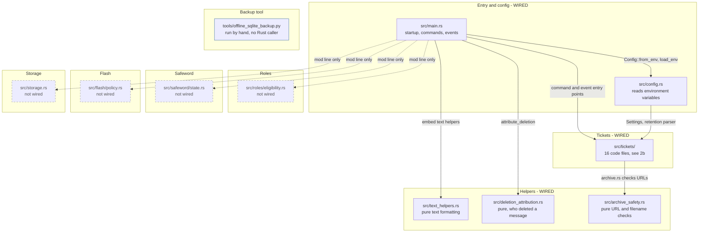
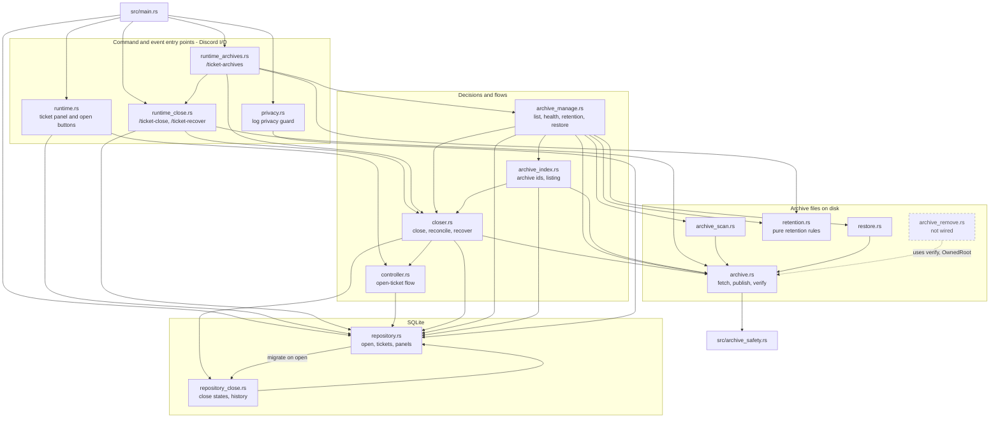
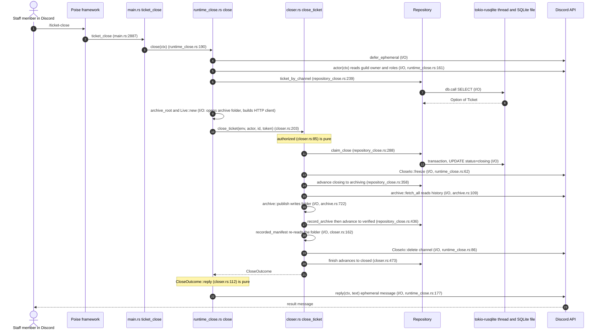
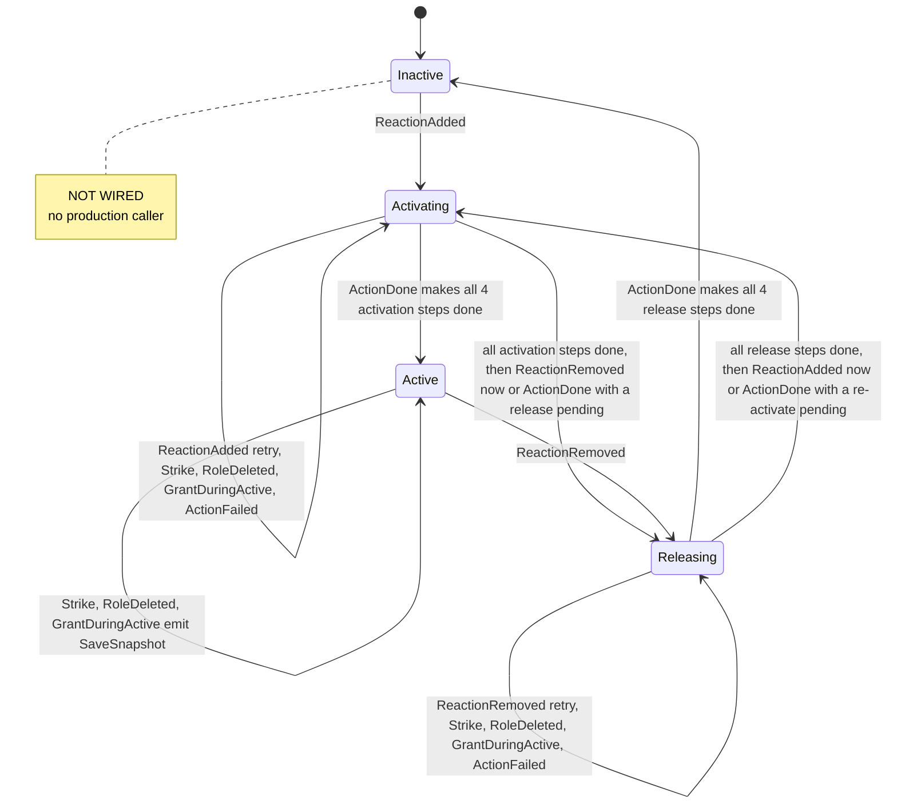
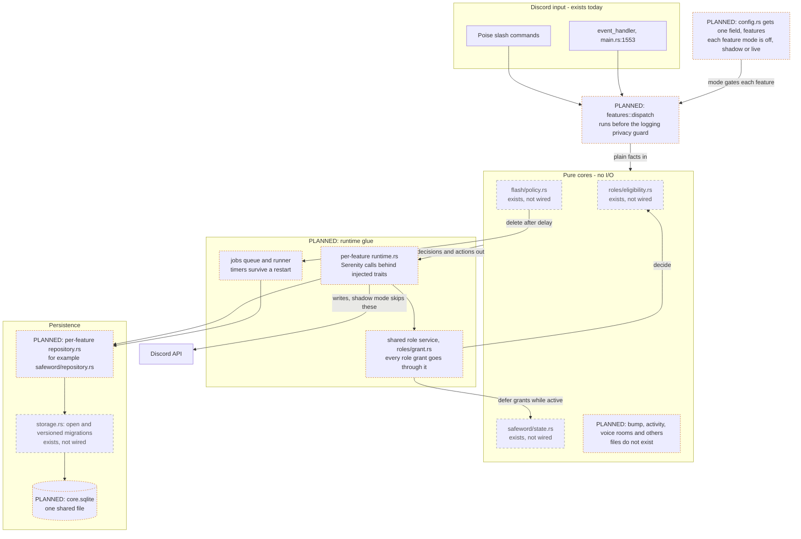

# Architecture map of SKYNET // NETWORK_CORE

This page is a picture of how the Rust code in `src/` fits together. It is written for a reader who is learning Rust. Every box, arrow and `file:line` reference was checked against commit `920c48b`. If you read this at a later commit, line numbers may have moved.

The Mermaid diagrams render on GitHub. If you read this as plain text, each diagram is followed by a short list that says the same thing in words.

## 1. How to read this

- A **box** is one real file or folder. A box name like `src/tickets/closer.rs` is the exact path.
- A **solid arrow** `A --> B` means: code in A really uses or calls code in B (a `use` line or a call). The arrow points at the thing being used.
- A **dashed arrow** `A -.-> B` means: A declares B with a `mod` line, but nothing calls B. A dashed box is a module in that state.
- **WIRED** means the code is called from `main.rs` at startup, in a slash command or in an event handler today. **NOT WIRED** means the module exists and has tests, but only its own tests call it (no production caller). **PLANNED** means it exists only in `consolidation-plan/PLAN.md`, not in the code.
- A *module* is Rust's word for a unit of code, usually one file or one folder with a `mod.rs`. A *pure* function does no I/O: same inputs always give the same output. *I/O* means touching Discord, SQLite, the disk or the clock.

## 2. Module map

### 2a. All areas (tickets shown as one box)

In words:

- `main.rs` is the root. It declares nine modules (`main.rs:1-9`) and is the only file that talks to the Poise framework and Serenity (the Discord library) directly.
- `config.rs` reads environment variables into a `Config` value. It builds the ticket `Settings` through `src/tickets/`.
- WIRED: `config`, `tickets`, `text_helpers`, `deletion_attribution`, `archive_safety`. Four are called from `main.rs`. `archive_safety` is called only by `tickets/archive.rs` (`archive.rs:11`).
- NOT WIRED: `roles/eligibility.rs`, `safeword/state.rs`, `flash/policy.rs`, `storage.rs`. `main.rs` has a `mod` line for each, and no code anywhere outside their own tests uses them. Each carries `#![allow(dead_code)]` to silence the compiler warning about unused code (`roles/mod.rs:3`, `safeword/mod.rs:2`, `flash/mod.rs:14`, `storage.rs:11`).
- The backup tool is a Python script, not Rust. No `.rs` file calls it. You run it yourself from a terminal.
- Not drawn, to keep the picture readable: `config.rs`, `tickets/` and `deletion_attribution.rs` each `use crate::Error` or `crate::Context` or `crate::AUDIT_MATCH_WINDOW_MS` from `main.rs` (for example `deletion_attribution.rs:4`). These are arrows back up to `main.rs`.
- Test-only: `tests/archive_input_safety.rs` and `tests/archive_input_properties.rs` pull `archive_safety.rs` in with `#[path]` (not a production caller).

### 2b. Inside `src/tickets/`

`policy.rs` (ticket settings and kinds) is used by almost every file here, so its arrows are left out. The three `*_tests.rs` files and `mod.rs` are also left out.

In words:

- **Entry points** are the files `main.rs` calls: `runtime.rs` (ticket panel and buttons), `runtime_close.rs` (`/ticket-close`, `/ticket-recover`, startup reconcile), `runtime_archives.rs` (`/ticket-archives`) and `privacy.rs` (a guard around the logger). `main.rs` also opens the `Repository` itself at startup (`main.rs:2971`).
- **Logic** files hold the rules. `closer.rs` decides who may close a ticket and in what order the steps run. Discord work is hidden behind a trait (`CloseIo`, see glossary). `runtime_close.rs` supplies the real Discord version of that trait.
- **Archive** files read and write the archive folder on disk. `retention.rs` is pure. `archive_remove.rs` is the one NOT WIRED file here: nothing calls `remove_archive_dir`, and `tickets/mod.rs:5` marks it `#[allow(dead_code)]`.
- **SQLite** access is only in `repository.rs` and `repository_close.rs`. They are two files for one type: `Repository` is defined in `repository.rs`, and `repository_close.rs` adds more methods to it. Each file imports the other.
- `config.rs` also uses `tickets/policy.rs` and `tickets/retention.rs` (see 2a).

## 3. One wired path end to end: `/ticket-close`

`/ticket-close` is a real slash command. It is registered only when ticket settings are valid and enabled (`main.rs:2922-2931`, called from `main.rs:2954`). Ticket *opening* is switched off by a compile-time constant (`runtime.rs:28`, `OPENING_APPROVED = false`), but close and archive are wired.

In the diagram, a step marked **pure** does no I/O. A step marked **I/O** touches Discord, SQLite, the disk or the clock.

In words:

1. **Poise to the command.** Poise matches `/ticket-close` to the function `ticket_close` (`main.rs:2886-2889`), which does nothing except call `tickets::runtime_close::close`.
2. **Adapter (`runtime_close::close`).** Does I/O. It acknowledges the interaction, builds an `Actor` (who is asking) and reads the ticket row by channel. If settings or the repository are missing, it replies "unavailable" and stops.
3. **Decision logic (`closer::close_ticket`).** Mostly a sequence of checks, then calls. `authorized` is pure. The ordering is the safety rule: authorize, claim, freeze, archive, re-read the archive from disk, re-check the live channel, only then delete. Any failure returns `Retained`, and the channel stays.
4. **Repository.** Each method (`claim_close`, `advance`, `record_archive` and so on) runs one short SQLite transaction through `self.db.call(...)`. `db` is a `tokio_rusqlite::Connection`, which runs SQLite on its own thread so the async bot is not blocked. No transaction is held while waiting on Discord.
5. **Reply.** `CloseOutcome::reply` turns the result into a fixed sentence (pure). `reply` sends it as a message only the user sees (I/O).

## 4. Safeword state machine (`src/safeword/state.rs`) - NOT WIRED

The safeword is a feature that takes away a member's restricted roles (so NSFW areas are hidden) and gives them back later. The code here is only the **decision core**. It holds no state, does no I/O and uses no Discord types (`state.rs:1-6`). A future runtime would call `step(&State, Event, &Context) -> (State, Vec<Action>)` (`state.rs:478`), then carry out the returned `Action`s and report back with `ActionDone` or `ActionFailed`. Nothing calls `step` outside the tests today.

In words:

- **Four states** (`State`, `state.rs:143-148`): `Inactive`, `Activating(Snapshot)`, `Active(Snapshot)`, `Releasing(Snapshot)`. `Snapshot` is the saved data: roles to restore, roles struck by staff, and a flag for each step (`Snapshot`, `state.rs:102`).
- **Events** (`Event`, `state.rs:90`): `ReactionAdded`, `ReactionRemoved`, `Strike(role)`, `RoleDeleted(role)`, `GrantDuringActive(role)`, `ActionDone(id)`, `ActionFailed(id, code)`.
- **Actions** the machine asks for (`Action`, `state.rs:62`): save a snapshot, remove roles, add the safeword role, send a DM, then the reverse on release.
- Moving from `Activating` to `Active` needs all four activation steps acknowledged (`activation_complete`, `state.rs:250`). If the reaction was removed in the meantime (`pending_release`), it goes straight on to `Releasing`. `Releasing` back to `Inactive` works the same way with the four release steps.
- `restart_action` (`state.rs:748`) says what to do after a restart. It is not drawn.
- Do not confuse this with `SafewordState` in `roles/eligibility.rs:36`. That is a different, two-value enum (`Inactive`, `Active`) that the roles rules take as input. No code links the two today.

## 5. PLANNED target flow (does not exist yet)

**Everything in this diagram marked PLANNED is a design, not code.** It comes from `consolidation-plan/PLAN.md` section 5 (kept outside this repository, in the verification project). Boxes marked "exists, not wired" are real files from section 2.

In words:

- The plan keeps the shape tickets already have: a pure `policy` core, a `repository` for SQLite, a `runtime` for Discord calls, then commands. Pure cores come first, and one dedicated "wiring" card connects them to `main.rs`.
- Every feature reads a mode: `off`, `shadow` (log what it would do, make no Discord writes) or `live`. Any other value means off.
- All new state goes into one new SQLite file, `core.sqlite`, opened by `storage.rs`. `tickets.sqlite` and `reaction_roles.sqlite` stay as they are.
- Timers (flash delete, bump reminder, voice room cleanup) would move into one durable `jobs` table, so a restart does not lose them.
- Every role grant would go through one shared service that uses `roles/eligibility.rs` and the safeword rules. The plan notes that today's reaction-role path has no such guard (PLAN.md section 5, item 6).

**Where the code and the plan disagree.** This page draws the code. At commit `920c48b`:

- The plan says each feature has `config.rs` and `command.rs` files, like tickets. The tickets folder has neither. Its settings parser is `ticket_settings` in `src/config.rs:152`, and its slash commands live in `main.rs:2878-2920`.
- The plan says the "unwired" allow sits next to the `mod` line in `main.rs`. In the code each module carries its own `#![allow(dead_code)]` (lines listed in 2a). `archive_remove` has `#[allow(dead_code)]` at `tickets/mod.rs:5`.
- The plan cites `main.rs:2592-2601` (command list), `main.rs:1247` (privacy guard) and `main.rs:2637` (global command registration). Today these are `main.rs:2922-2931`, `main.rs:1561` (the `tickets::privacy::guarded` call inside `event_handler`) and `main.rs:2967`.
- `CORE_DB_PATH`, `features.rs`, `jobs` and the other planned modules appear nowhere in `src/`.

## 6. Rust glossary for this codebase

Each entry points at a real example. Lines are at commit `920c48b`.

1. **Enum with data**: a type that is one of several shapes, and some shapes carry values. `State::Activating(Snapshot)` holds a `Snapshot` (`src/safeword/state.rs:143-148`). `Action::RemoveRoles(Vec<RoleId>)` carries a list (`state.rs:62-64`).
2. **`Result` and `?`**: `Result<T, E>` is "a value or an error". `?` returns the error early or unwraps the value. See `HttpDownloader::new(...)?` (`src/tickets/runtime_close.rs:34`) and `ctx.defer_ephemeral().await?` (`runtime_close.rs:191`).
3. **Trait**: a list of methods a type promises to have. `CloseIo` (`src/tickets/closer.rs:69`) lists what the closer needs from Discord. `Live` implements it for real (`runtime_close.rs:61`), and tests can implement it with a fake.
4. **`impl` block**: where a type's methods are written. `impl Repository` (`src/tickets/repository.rs:66`). A type may have several blocks, in several files: a second one is at `src/tickets/repository_close.rs:213`.
5. **`Option`**: "a value, or nothing" (`Some(x)` or `None`). `ticket_by_id` returns `Result<Option<Ticket>, Error>`, so "database error" and "no such ticket" are different answers (`repository_close.rs:225`). `State::snapshot` returns `Option<&Snapshot>` (`state.rs:153`).
6. **Ownership and borrowing**: every value has one owner. `&T` borrows it read-only, `&mut T` borrows it so you may change it. `step(state: &State, ...)` only reads the old state and returns a new one (`state.rs:478`). `retry_release_actions(&mut self)` changes the snapshot in place (`state.rs:301`).
7. **`Arc`**: a shared, reference-counted pointer, so many tasks can hold one value safely. `Repository` holds `db: Arc<Connection>` (`src/tickets/repository.rs:24`). `Data` holds `config: Arc<Config>` (`src/main.rs:44`).
8. **`async` / `.await`**: an `async fn` can pause while it waits (for Discord or SQLite) and let other work run. `.await` is the pause point. `pub async fn close(...)` (`runtime_close.rs:190`) awaits at its first line (`:191`).
9. **`#[derive(...)]`**: asks the compiler to write common trait code for you (`Clone`, `Debug`, `PartialEq` and so on). `#[derive(Clone)]` on `Repository` (`repository.rs:22`). `#[derive(Clone, Debug, Default, PartialEq, Eq)]` on `State` (`state.rs:142`).
10. **`mod` and `pub`**: `mod x;` declares a module, so the compiler reads `x.rs`. Without `pub`, things are private. `mod archive_safety;` (`src/main.rs:1`) is private to the crate root. `pub mod archive;` (`src/tickets/mod.rs:1`) lets sibling modules use it. `pub(super)` limits something to the parent module (`runtime_close.rs:161`).
11. **Lifetimes and generics** (bonus): `Env<'a, I: CloseIo>` (`closer.rs:123`) borrows its parts for a lifetime `'a` and works with any type `I` that implements `CloseIo`.

## How this page was checked

See the review request on card `t_449a11fe` for the exact commands. Short version: `use`, `mod` and call edges were checked with `grep`. NOT WIRED claims were checked by grepping for the module name outside the module's own files. Line numbers were read back from the files. **The Mermaid blocks were not rendered**: no Mermaid CLI is installed offline, and the task bans network use. They were re-read against Mermaid syntax by hand.
