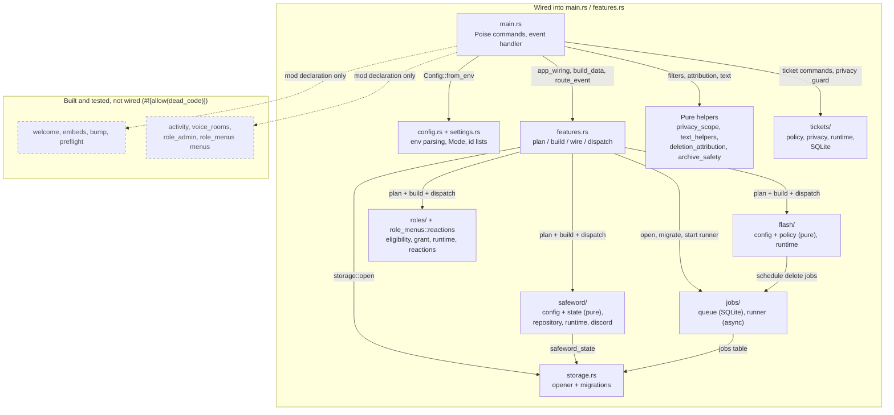
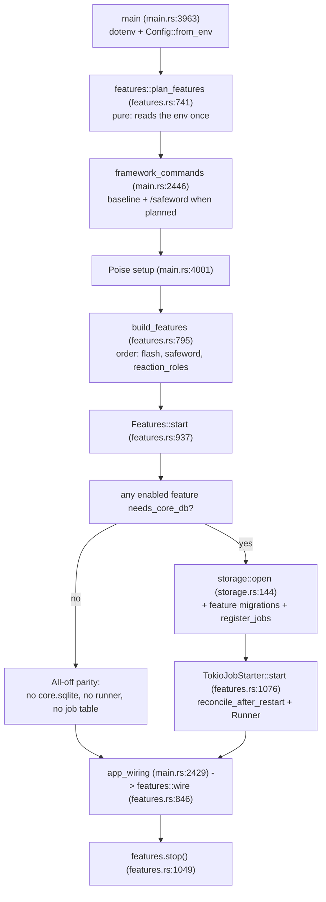
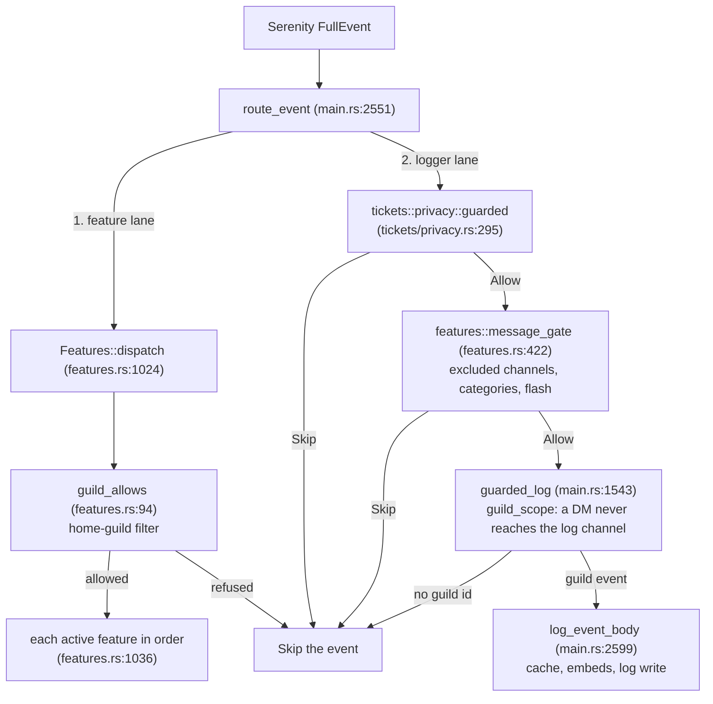
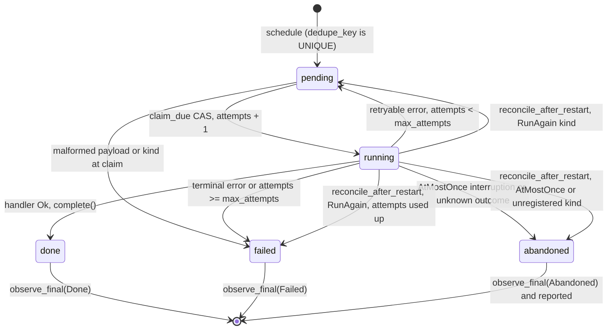
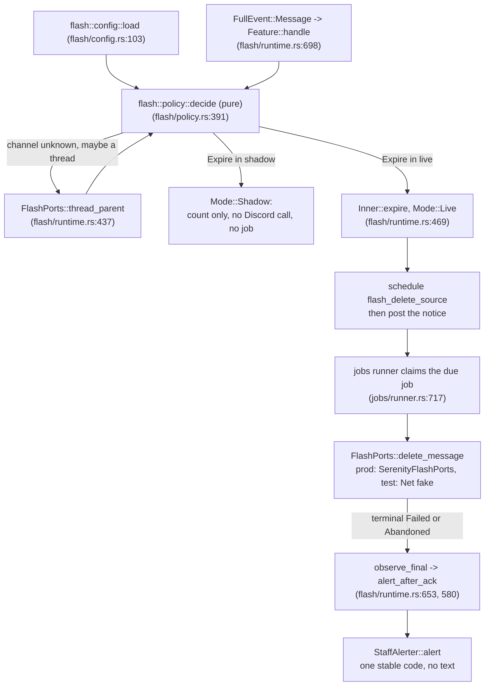
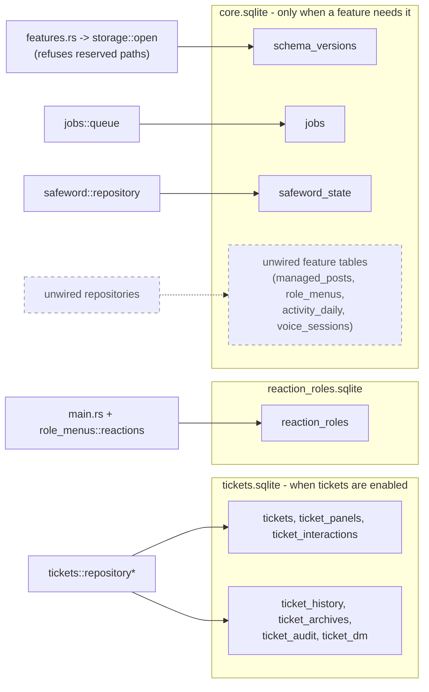

# Architecture map of SKYNET // NETWORK_CORE

This page is a map of the Rust code in `src/` at commit `42d176e`. It is written for a reader
who knows some Rust and wants to learn how the bot is put together. Every section gives the
plain-English story first, then a Mermaid diagram.

Two conventions run through the whole codebase and explain most of its shape:

- **Pure core, thin runtime.** The decision logic of a feature (what *should* happen) lives in
  a module with no Discord types, no clock and no I/O. The runtime (what *does* happen) is a
  thin layer that reaches Discord and SQLite through injected traits, so the decisions can be
  tested offline.
- **Off by default, fail closed.** A feature only runs when its `*_MODE` key says so, and
  whenever a lookup, permission check or setting is missing or ambiguous, the bot refuses the
  action rather than guessing.

## 1. Module map

`src/main.rs:1-21` declares 21 top-level modules. They fall into three kinds:

- **Pure logic** — no I/O, no clock, no Discord types: `settings`, `privacy_scope`,
  `text_helpers`, `deletion_attribution`, `archive_safety`, and the `policy` / `config` /
  `render` sub-modules of the feature folders.
- **SQLite** — `storage` (the opener and the migration runner), `jobs::queue`, and the
  `repository` sub-modules.
- **Discord adapters and runtimes** — `main` (the Poise/Serenity glue), `features` (the
  registry), the `runtime` / `command` sub-modules, and `jobs::runner`.

Not every module is live. The wave-3 to wave-5 features are built and tested but have **no
production caller**: their `mod.rs` still carries `#![allow(dead_code)]`, which is the marker
the project uses for "not wired yet". Read the marker, not the folder name.

| Module | Kind | Wired? |
| --- | --- | --- |
| `main`, `features`, `config`, `settings` | entry, registry, parsing | yes |
| `tickets` | policy + SQLite + runtime | yes (opening stays gated) |
| `safeword` | pure state + SQLite + Discord runtime | yes |
| `flash` | pure policy + runtime | yes |
| `role_menus::reactions` | SQLite + Discord | yes |
| `roles` | pure policy + Discord adapter | yes (via `safeword::discord`) |
| `jobs` | SQLite queue + async runner | yes (via `features`) |
| `storage` | SQLite opener + migrations | yes |
| `privacy_scope`, `text_helpers`, `deletion_attribution`, `archive_safety` | pure helpers | yes |
| `activity`, `bump`, `embeds`, `preflight` | modules | **no** (`#![allow(dead_code)]`) |
| `role_admin`, `voice_rooms`, `welcome` | modules | **no** (`#![allow(dead_code)]`) |
| `role_menus::{command, interactions, policy, repository}` | sub-modules | **no** |



## 2. Startup flow

Startup is split into a **pure planning** phase and a **live** phase, so that the moment every
optional feature is off (the shipped default) nothing extra happens at all.

1. `main` (`src/main.rs:3963`) loads the `.env` file if there is one and parses
   `Config::from_env()` (`src/config.rs:156`). The bot token is the only secret, and `Config`'s
   own `Debug` implementation replaces it with `<redacted>` (`src/config.rs:102`).
2. `features::plan_features` (`src/features.rs:741`) reads the environment **once** and decides
   which optional features are on. It is pure: no Discord, no I/O. With every `*_MODE` unset the
   plan is empty. A feature that is requested but cannot run stays off and produces one line
   naming the key and a stable code (`src/features.rs:585`).
3. `framework_commands` (`src/main.rs:2446`) builds the slash-command list: the baseline
   commands plus `/safeword` only when the plan has the safeword
   (`src/main.rs:3952`). With an empty plan the list is exactly the baseline list.
4. Inside Poise's `setup` callback (`src/main.rs:4001`), the bot opens the reaction-role
   database, optionally opens the ticket database, reconciles interrupted tickets, builds the
   planned features with `features::build_features` (`src/features.rs:795`) and hands them to
   `Features::start` (`src/features.rs:937`).
5. `Features::start` opens `core.sqlite` **only** when an enabled feature says it needs it
   (`needs_core_db`), and starts the job runner **only** when a feature registered a job kind
   (`src/features.rs:956`). That is where all-off parity is enforced: no database file, no
   runner task, no job table.
6. `app_wiring` (`src/main.rs:2429`) turns the plan plus "which features really started" into
   the `Wiring` decisions (`src/features.rs:846`): does the new reaction-role path own the
   reaction events (so the legacy arms stand down), is the safeword live, and which channels
   must the logger skip.
7. On shutdown, `features.stop()` (`src/features.rs:1049`) asks the runner to stop and waits
   for it (`src/main.rs:4110`).



## 3. Event flow

One gateway event travels through two lanes in `route_event` (`src/main.rs:2551`): the
**feature lane** first, then the **logger lane**. The order matters: a feature must never be
skipped because the logger's privacy guard said no.

1. `Features::dispatch` (`src/features.rs:1024`) applies the home-guild filter:
   `guild_filter` turns the configured `GUILD_ID` into `GuildFilter::Only`, `Any` or `Closed`
   (`src/features.rs:79`), and `guild_allows` (`src/features.rs:94`) decides per event. With a
   single guild configured, only an event that provably belongs to it passes; a `GUILD_ID` that
   was set but unreadable closes the filter instead of widening it to every guild.
2. Each surviving feature is awaited in registration order (`src/features.rs:1036`). Dispatch
   never touches the message cache.
3. The logger lane runs the ticket privacy guard first: `tickets::privacy::guarded`
   (`src/tickets/privacy.rs:295`) decides whether the channel is private. The decision is
   fail-closed: a channel that was ever linked to a ticket, a ticket category, or a lookup
   that could not be resolved all mean *skip* (`src/tickets/privacy.rs:186`).
4. Inside that guard, the log-exclusion gate (`features::message_gate`,
   `src/features.rs:422`) drops the four message events from excluded channels and
   categories, and from the flash channels. An exclusion list that could not be read blocks
   every guild message rather than silently dropping the exclusion.
5. Only when both gates allow does the sink run: `log_event` (`src/main.rs:2583`) first checks
   that the event provably belongs to a guild (`guild_scope`, `src/main.rs:1515`), so a DM or
   group DM can never reach the staff log channel, then `log_event_body`
   (`src/main.rs:2599`) builds the embed and writes it.
6. Inside `log_event_body`, the legacy reaction-role arms stand down when the new feature
   owns the events (`legacy_reaction_roles_active`, `src/main.rs:2482`).



## 4. Job queue and runner

Durable timers live in the `jobs` table of `core.sqlite`. The queue (`src/jobs/queue.rs`) is
synchronous and Discord-free: every function takes the connection and the current time from the
caller, so no clock is read inside it and every result is reproducible.

- **States** (`JobState`, `src/jobs/queue.rs:118`): `pending`, `running`, `done`, `failed`,
  `abandoned`. The schema enforces exactly this set with a `CHECK` constraint
  (`src/jobs/queue.rs:55`). `done`, `failed` and `abandoned` are terminal and never change
  again (`src/jobs/queue.rs:149`).
- **Claiming** is a compare-and-swap: one `UPDATE ... WHERE state = 'pending' AND due_at <= now`
  moves the row to `running` and bumps `attempts` (`src/jobs/queue.rs:425`). Exactly one claimer
  wins; the others see nothing.
- **Retries**: `fail` (`src/jobs/queue.rs:522`) puts the row back to `pending` at
  `now + backoff` while claims used are below `max_attempts`, and makes it terminally `failed`
  when they are not. The backoff is `min(cap, base * 2^(attempts-1))`
  (`src/jobs/queue.rs:212`). The default policy is base 30 s, cap 600 s, 5 attempts
  (`src/jobs/queue.rs:196`).
- **Per-kind retry policy**: a kind may register its own policy with
  `Registry::register_with_retry` (`src/jobs/runner.rs:227`), which is also the policy used
  when the kind is reconciled after a restart.
- **Terminal errors**: a handler reports failure with a `&'static str` code
  (`HandlerError`, `src/jobs/runner.rs:132`), so no runtime text can ride along. A code that is
  not a plain token is stored as `invalid_error_code` (`src/jobs/queue.rs:564`).
- **Final-ack observer**: `Registry::observe_final` (`src/jobs/runner.rs:246`) installs a
  best-effort callback that fires **after** the final acknowledgement is committed, with
  `FinalOutcome::Done`, `Failed` or `Abandoned` (`src/jobs/runner.rs:178`). It is for
  reporting, not for deciding to retry (`src/jobs/runner.rs:705`).
- **Restart reconciliation**: `reconcile_after_restart` (`src/jobs/queue.rs:663`) resolves the
  rows a dead process left in `running`, once, before anything is claimed. A `RunAgain` kind
  goes back to `pending`; a `RunAgain` kind whose attempts are used up becomes `failed`; an
  `AtMostOnce` kind, or a kind that is not registered at all, becomes `abandoned` and is
  reported (`src/jobs/queue.rs:695`).
- **The rule**: the SQLite row is the truth and a queued job is a **disposable wake-up**. The
  handler re-reads the state it depends on and does nothing if the state already advanced
  (for example `src/voice_rooms/runtime.rs:9`, `src/bump/runtime.rs:11`).



## 5. A feature end to end: `flash`

The flash feature expires media posts in the configured flash channels after a delay. It is a
good example because every layer is visible.

1. **Config** — `flash::config::load` (`src/flash/config.rs:103`) parses `FLASH_MODE`,
   `FLASH_CHANNEL_IDS`, `FLASH_PING_ROLE_ID`, `FLASH_DELAY_SECS` and `FLASH_INCLUDE_THREADS`
   through the shared helpers in `settings`. A refused value switches the feature off and
   names the key only; the value is never echoed (`src/flash/config.rs:175`).
2. **Pure policy** — `flash::policy::decide` (`src/flash/policy.rs:391`) takes plain
   `MessageFacts` and returns `Decision::Expire(ExpirePlan)` or
   `Decision::Ignore(IgnoreReason)`. It reads no clock, looks up no id and holds no serenity
   type. The notice text is rendered from the role id, the author id and the channel id only,
   so the flashed message's content can never be quoted or inject a mention
   (`src/flash/policy.rs:441`).
3. **Runtime over traits** — `Inner::process` (`src/flash/runtime.rs:419`) runs the policy and
   reacts to the mode: `off` does nothing, `shadow` only counts what it *would* do
   (`src/flash/runtime.rs:458`), and `live` schedules the deletes and posts the notice
   (`Inner::expire`, `src/flash/runtime.rs:469`). The source delete is scheduled **before** the
   notice is posted, so a crash between the two steps cannot leave the media undeleted
   (`src/flash/runtime.rs:14`).
4. **Serenity adapter** — `SerenityFlashPorts` (`src/flash/runtime.rs:755`) implements both
   `FlashPorts` (`src/flash/runtime.rs:765`) and `StaffAlerter`
   (`src/flash/runtime.rs:844`) over serenity's HTTP client and cache:
   `send_notice`, `delete_message` and `thread_parent`. A delete that returns 404 counts as
   done (`delete_verdict`, `src/flash/runtime.rs:223`).
5. **Alert** — the final-ack observer registered by `register_job_kinds`
   (`src/flash/runtime.rs:653`) turns a terminal failure into one staff alert carrying a stable
   code and nothing else (`alert_text`, `src/flash/runtime.rs:127`).

**Why the `Env` / ports-trait pattern exists.** The runtime never calls Discord or the clock
directly; it goes through a trait, so a test can substitute a fake and drive every branch
offline. Two shapes of the same idea are in the code:

- A **ports trait** per side effect, injected as `Arc<dyn Trait>` into a deps struct
  (`FlashPorts`, `StaffAlerter`, `Clock` — `src/flash/runtime.rs:133`, `:147`).
- An **`Env` trait** that gathers the collaborators of one command
  (`safeword::command::Env`, `src/safeword/command.rs:291`), implemented in production by
  `RuntimeEnv` (`src/safeword/discord.rs:436`) and by a fake in the tests.

```rust
// Real code, src/safeword/command.rs:291
pub trait Env {
    /// The configuration.
    fn config(&self) -> &CommandConfig;
    /// The unix second the call happens in.
    fn now(&self) -> i64;
    /// The SW3 collaborators for the home guild.
    fn ops(&mut self) -> &mut Ops;
    /// The pending `clear` confirmations.
    fn confirms(&mut self) -> &mut ConfirmBook;
}
```



## 6. Data stores

Three SQLite files exist, each with one owner. `storage::open` (`src/storage.rs:144`)
normalises the path and **refuses** any path that resolves to a reserved file, so the core
database can never alias the ticket or reaction-role file
(`StorageError::ReservedPath`, `src/storage.rs:21`).

- **`tickets.sqlite`** (`TICKET_DB_PATH`) — owned by `tickets::repository` and
  `tickets::repository_close`. Opened only when the ticket settings are valid
  (`src/main.rs:4016`). Holds `tickets` (`src/tickets/repository_close.rs:108`),
  `ticket_panels`, `ticket_interactions`, `ticket_history`, `ticket_archives`, `ticket_audit`
  and `ticket_dm` (`src/tickets/repository_close.rs:115-120`).
- **`reaction_roles.sqlite`** (`REACTION_ROLE_DB_PATH`) — owned by `main` and
  `role_menus::reactions`. Holds the `reaction_roles` table
  (`src/main.rs:2002`, `src/role_menus/reactions.rs:26`).
- **`core.sqlite`** (`CORE_DB_PATH`) — owned by `storage` and the features that migrate into
  it. Opened **only** when an enabled feature needs the database
  (`src/features.rs:956`). It holds `schema_versions` (the migration ledger,
  `src/storage.rs:237`) plus the per-feature tables:
  - `jobs` — the durable queue (`src/jobs/queue.rs:49`).
  - `safeword_state` — the safeword snapshot per member (`src/safeword/repository.rs:24`).

  The wave-3 to wave-5 features also declare their migrations here, and those tables are
  created **only when their feature is wired and switched on**: `managed_posts`
  (`src/embeds/posts.rs:52`), `role_menus` and `role_menu_options`
  (`src/role_menus/repository.rs:28`), `activity_daily` and `voice_sessions`
  (`src/activity/repository.rs:12`, `:25`), `bump_state`
  (`src/bump/repository.rs:29`), and `voice_rooms` and `voice_room_deputies`
  (`src/voice_rooms/repository.rs:26`, `:40`).



## 7. Safety rules you can rely on

- **Shipped OFF by default.** An unset, blank or unrecognised `*_MODE` parses to `Mode::Off`
  (`src/settings.rs:48`), and the plan is empty when every mode is unset
  (`src/features.rs:741`).
- **Fail closed.** An unreadable `GUILD_ID` closes the feature filter instead of widening it
  (`src/features.rs:79`); an unresolvable channel is skipped by the ticket privacy guard
  (`src/tickets/privacy.rs:262`); a refused setting leaves the feature off
  (`src/features.rs:585`).
- **Stable codes, never values, in logs and alerts.** Errors are fixed `snake_case` codes
  (`StorageError::code`, `src/storage.rs:34`; `QueueError::code`, `src/jobs/queue.rs:82`;
  `alert_text`, `src/flash/runtime.rs:127`), and the start-up lines carry counts and states
  only (`ReportCounts::line`, `src/features.rs:214`).
- **Home-guild scope.** The feature lane is limited by `guild_allows`
  (`src/features.rs:94`), and a `GUILD_ID` that was set but unusable closes the filter
  (`src/features.rs:79`).
- **Staff-only commands.** `/age-verified` requires a member of the configured staff role
  (`src/main.rs:2173`), the safeword write subcommands are staff-gated
  (`gate_staff_write`, `src/safeword/command.rs:422`), and the ticket closer checks staff or
  guild owner (`src/tickets/closer.rs:85`).
- **No secrets.** The bot token is the only credential in `Config`, and `Config`'s `Debug`
  implementation prints `<redacted>` in its place (`src/config.rs:102`).
- **Private events never reach the staff log channel.** An event with no guild id (a DM or
  group DM) is refused by `guild_scope` (`src/main.rs:1515`), and ticket-linked channels are
  refused by the privacy guard (`src/tickets/privacy.rs:186`).

## 8. Glossary

- **Shadow mode** — a feature mode that runs the real policy on live events and only counts
  what it would have done, making no Discord write and no database change
  (`src/settings.rs:40`, `src/flash/runtime.rs:458`).
- **Wiring lane** — the thin integration layer (`features.rs` and the `setup` block in
  `main.rs`) that connects the independently tested feature modules to the environment, to
  `core.sqlite`, to the job runner and to the event stream.
- **Stable code** — a fixed `snake_case` identifier logged or alerted in place of a raw value
  or a piece of user text (`src/jobs/queue.rs:82`).
- **Fail closed** — the rule that a missing, ambiguous or failed lookup, permission check or
  setting makes the bot refuse the action instead of guessing
  (`src/tickets/privacy.rs:262`).
- **Row is the truth** — the durability rule that the domain state lives in a SQLite row while
  a queued job is a disposable wake-up: the handler re-reads the state and does nothing if it
  already advanced (`src/voice_rooms/runtime.rs:9`).
- **AtMostOnce** — the restart policy for an effect that must never be repeated: if the job is
  interrupted, the row becomes `abandoned` and is reported instead of being run again
  (`src/jobs/queue.rs:162`).
